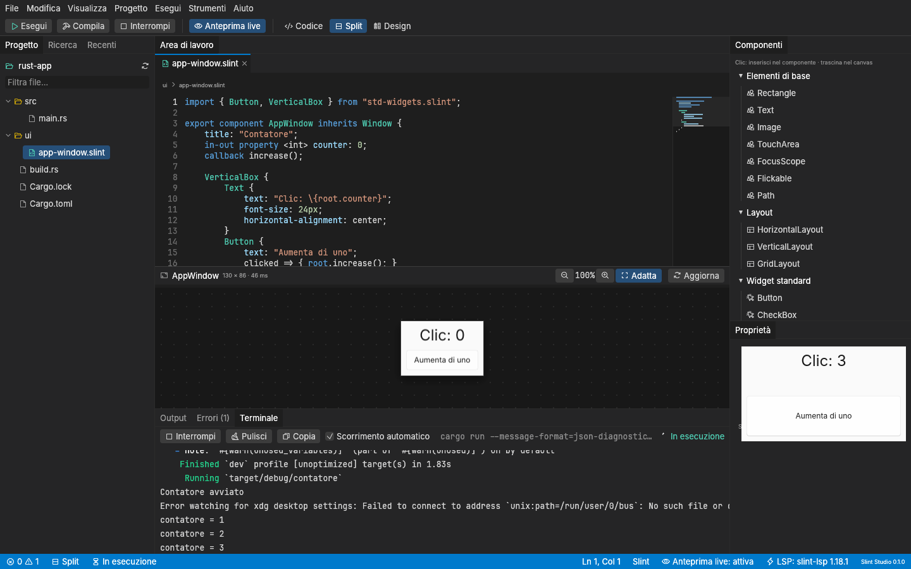

# Slint Studio

A desktop IDE for the [Slint](https://slint.dev) UI toolkit, inspired by Qt Creator:
`.slint` code editor, visual designer and live preview in a single application.

The IDE shell is written in Rust with [egui](https://github.com/emilk/egui) / eframe;
the language server is `slint-lsp`, the live preview uses `slint-interpreter`, `.slint`
files are checked with `i-slint-compiler`, and Rust projects are built and run with
`cargo`.

Slint Studio is free software released under the **GNU GPLv3** (see
[License](#license)).

> [!IMPORTANT]
> **Slint Studio was created largely with artificial intelligence.**
> See [Built with AI](#built-with-ai).

> [!NOTE]
> The user interface is currently in **Italian**. In this document, menu and button
> names are given in Italian with their English meaning, e.g. *Esegui* (Run).



## Built with AI

Slint Studio is a project made **predominantly with artificial intelligence**: code
architecture, implementation, tests and documentation were written almost entirely by
an AI assistant ([Claude Code](https://claude.com/claude-code) by Anthropic), starting
from the author's specification.

The work went through phases (see [Status](#status)). The author defined the
requirements, the stack and the quality constraints, made the technical decisions
(license, automatic download of the Slint tools, use of internal Slint APIs, supported
project types) and approved moving from one phase to the next. Every phase was
verified with automated tests, `clippy` and hands-on runs of the real IDE, but this is
still experimental software: please report problems in the
[issues](https://github.com/ellebi2000/SlintStudio/issues).

The git history reflects this: every commit lists the AI assistant as co-author
(`Co-Authored-By: Claude`).

## Status

| Phase | Scope | Status |
|-------|-------|--------|
| 0 | Cargo workspace, egui shell, dark theme, dockable panels | ✅ done |
| 1 | Opening projects, file tree, editor with syntax highlighting, LSP client | ✅ done |
| 2 | Live preview with `slint-interpreter`, file watcher, error overlay | ✅ done |
| 3 | Designer: element selection, editor↔canvas sync, properties, palette | ✅ done |
| 4 | Building and running the project, integrated terminal | ✅ done |
| 5 | Layout persistence, shortcuts, command palette, light theme, documentation | ⏳ |

Phase 5 features are already visible in the menus but disabled; their tooltip says
which phase will bring them.

## Features

- **Project**: open a folder (native dialog, command-line argument or *Recenti* —
  Recent), file tree with filter, text search across all project files. The main file
  (`main.slint`, `app-window.slint`, …) opens automatically.
- **Editor**: Slint syntax highlighting, line numbers, clickable minimap, breadcrumb with
  the file path and the elements enclosing the cursor (e.g.
  `MainWindow › VerticalBox › Card`), tabs for open files, automatic indentation, Tab
  inserts four spaces.
- **Language server** (`slint-lsp`): errors and warnings underlined in the code (with
  tooltips), in the gutter, in the minimap and in the **Errori** (Problems) panel —
  click to jump to the line; code completion; go to definition.
- **Live preview**: the canvas shows the component rendered by `slint-interpreter` (the
  last exported component of the active file). It updates 300 ms after the last edit,
  **without saving** (unsaved buffers, including those of imported files, are passed to
  the compiler), and whenever a project file changes outside the IDE. On errors the
  last valid preview stays visible, dimmed, with the list of errors (click to jump to
  the line). Zoom with the buttons or `Ctrl`+wheel, *Adatta* (Fit) to see it whole,
  *Aggiorna* (Refresh) to redraw manually (even with live preview turned off).
- **Designer** (Split and Design modes):
  - **selection**: click an element in the canvas (dashed outline, label with name and
    size, hover outline); the editor cursor jumps to its declaration. Conversely,
    moving the cursor in the editor selects the enclosing element, and a bar in the
    editor gutter marks its lines;
  - **handles**: drag them to resize the element (`width`/`height`, plus `x`/`y` for
    the left and top edges when it is not inside a layout);
  - **properties**: the panel shows the properties of the selected element, grouped
    into Geometry, Appearance and Behaviour, plus those already written in the code.
    Empty fields show the value computed by the preview; text without quotes, colors
    with a picker, enumerations with a menu. Every change rewrites the `.slint` code (in
    the buffer, to be saved) and updates the preview immediately;
  - **palette**: click a component to insert it into the selected element (or the
    component), or drag it onto the desired container in the canvas; the import from
    `std-widgets.slint` is added when needed. Elements that do not accept children
    (e.g. `Text`, `Button`) pass the new component on to their container;
  - **deletion**: *Elimina* (Delete) button in the panel or `Del` in the canvas; `Esc`
    clears the selection.
- **Build and Run** — *Compila* and *Esegui* (toolbar, *Esegui* menu, `Ctrl+B` /
  `Ctrl+R`), depending on the project type:

  | Project | Build | Run |
  |---------|-------|-----|
  | Rust (`Cargo.toml` in the opened folder) | `cargo build` | `cargo run` |
  | `.slint` files only | checks every `.slint` file with the Slint compiler | checks and opens the previewed file with `slint-viewer --auto-reload` |

  Modified files are saved first. Errors and warnings (from rustc, from the Slint
  compiler and from `.slint` files compiled by `slint-build` in `build.rs`) appear in
  the **Errori** (Problems) panel and underlined in the editor, without duplicating
  those already reported by `slint-lsp`; when the build fails the panel opens by
  itself. A build diagnostic disappears once its file is edited. *Esegui* (Run) starts
  nothing if the code does not compile. *Interrompi* (Stop, `Shift+F5`) terminates the
  build or the program together with the processes it started.
- **Terminal** (*Terminale*): live output of cargo, of the compiler and of the program,
  with ANSI colors; *Pulisci* (Clear), *Copia* (Copy) and auto-scroll. The status bar
  shows the state (building, downloading, running, result). It is an output panel, not
  an interactive shell.
- **External changes**: open, unmodified files are reloaded when they change on disk
  (also when they are replaced, as `sed -i`, many editors and `git` do); the project
  tree updates itself.
- **Data safety**: unsaved changes are flagged (tab, status bar), and closing a file, a
  project or the application asks for confirmation.

### Keyboard shortcuts

| Shortcut | Action |
|----------|--------|
| `Ctrl+O` | Open project folder |
| `Ctrl+S` / `Ctrl+Shift+S` | Save / Save all |
| `Ctrl+W` | Close the active file |
| `Ctrl+Space` | Trigger completion (also opens by itself after `.` or at the start of a word) |
| `F12` or `Ctrl+click` | Go to definition |
| `Ctrl+Shift+F` | Search in project files |
| `Ctrl+Z` / `Ctrl+Y` | Undo / Redo |
| `Ctrl+B` | Build |
| `Ctrl+R` | Run |
| `Shift+F5` | Stop the build or the program |

On macOS `Ctrl` means `Cmd` (except for `Ctrl+Space`).

## Requirements

- **Rust ≥ 1.95** (tested with 1.97). Install it from <https://rustup.rs>.
- **Linux, to build**: a C compiler, `pkg-config` and the fontconfig development
  files (Slint uses fontconfig to find fonts). The same packages are needed to build
  any Rust + Slint application, including the ones you run from the IDE.

  | Distribution | Command |
  |--------------|---------|
  | Ubuntu / Debian | `sudo apt-get install -y build-essential pkg-config libfontconfig-dev` |
  | Fedora | `sudo dnf install -y gcc pkgconf-pkg-config fontconfig-devel` |
  | Arch Linux | `sudo pacman -S --needed base-devel fontconfig` |
  | openSUSE | `sudo zypper install -y gcc pkg-config fontconfig-devel` |

  Without them the build stops with ``The system library `fontconfig` required by crate
  `yeslogic-fontconfig-sys` was not found``.
- **Linux, to run**: the X11/Wayland and OpenGL runtime libraries, and those used by the
  prebuilt `slint-lsp`; a desktop system already has them. On minimal Ubuntu/Debian:

  ```bash
  sudo apt-get install -y libxkbcommon-x11-0 libgl1 libegl1 libinput10 libgbm1 libfontconfig1
  ```

- **Windows / macOS**: no extra dependencies.
- **Rust projects**: building and running them needs `cargo` in the `PATH` (or in
  `~/.cargo/bin`); the rustup proxy is used, so the project's `rust-toolchain.toml` is
  honoured.

## Build and run

```bash
git clone https://github.com/ellebi2000/SlintStudio.git
```

```bash
cd SlintStudio
```

```bash
cargo run --release
```

Opening a project directly:

```bash
cargo run --release -- path/to/project
```

The resulting binary is `target/release/slint-studio` (`slint-studio --help` lists the
options).

### Installation

```bash
cargo install --path crates/slint-studio-app
```

```bash
slint-studio --install-lsp
```

```bash
slint-studio --install-viewer
```

The last two commands download the language server and `slint-viewer` right away (see
below); they are optional, since the IDE downloads them on first use anyway.

### The `slint-lsp` language server

Slint Studio uses its own copy of `slint-lsp` **1.18.1**, the same Slint version as the
preview:

1. if the `SLINT_STUDIO_LSP` variable points to an executable, that one is used;
2. otherwise the copy managed by the IDE is used, if already installed;
3. otherwise, when the first project is opened, the IDE **downloads it automatically**
   from the [official Slint releases](https://github.com/slint-ui/slint/releases)
   (progress in the status bar), verifies the **SHA-256** checksum pinned in the code
   and installs it;
4. if the download fails, a `slint-lsp` found in the `PATH` is used; if there is none,
   the status bar shows the error and how to fix it.

Location of the managed copy (license files in `licenses/`):

| System | Folder |
|--------|--------|
| Linux | `~/.local/share/slint-studio/slint-lsp/1.18.1/` |
| macOS | `~/Library/Application Support/dev.slint-studio.slint-studio/slint-lsp/1.18.1/` |
| Windows | `%APPDATA%\slint-studio\slint-studio\data\slint-lsp\1.18.1\` |

The download honours `HTTPS_PROXY`/`NO_PROXY` and uses the operating system's
certificates (works behind corporate proxies). Platforms with a prebuilt binary: Linux
x86_64 and aarch64, macOS (universal), Windows x86_64 and arm64; elsewhere install
`slint-lsp` with `cargo install slint-lsp --version 1.18.1`.

### `slint-viewer`

In projects made only of `.slint` files, *Esegui* (Run) opens the component in a real
window with `slint-viewer` **1.18.1**, managed like `slint-lsp`: the
`SLINT_STUDIO_VIEWER` variable can point to an executable; otherwise, on the first run,
the IDE downloads the official release (progress in the Terminal panel and the status
bar), verifies its **SHA-256** checksum and installs it in
`…/slint-studio/slint-viewer/1.18.1/` (same base folders as `slint-lsp`); if the
download fails, a `slint-viewer` found in the `PATH` is used. The viewer runs with
`--auto-reload`: saving the file updates the window.

### Command-line preview

The preview renderer is also available as an example, useful to check how a file is
drawn or to generate images:

```bash
cargo run --release -p slint-studio-preview --example render -- ui/main.slint preview.png 2
```

The last argument is the scale factor (2 = HiDPI).

### Graphics renderer

By default the IDE uses **wgpu** (Vulkan / Metal / DirectX 12). If initialization fails —
typical of virtual machines, remote desktops or old GPUs — it automatically falls back
to **OpenGL** (glow). To force a backend:

```bash
SLINT_STUDIO_RENDERER=glow cargo run
```

### Logs

Logs go to stderr and to the **Output** panel (including `slint-lsp` messages). Set the
level with `RUST_LOG`:

```bash
RUST_LOG=debug cargo run
```

### Fonts

At startup the IDE looks for **Inter** (interface) and **JetBrains Mono** (code) on the
system. If they are missing, a system monospace font (Cascadia Mono, Menlo, Consolas,
DejaVu Sans Mono, …) and egui's default fonts are used.

## Tests and quality

```bash
cargo test --workspace
```

```bash
cargo clippy --workspace --all-targets -- -D warnings
```

```bash
cargo fmt --all --check
```

Additional tests, excluded by default:

```bash
SLINT_STUDIO_LSP=~/.local/share/slint-studio/slint-lsp/1.18.1/slint-lsp cargo test -p slint-studio-lsp --test slint_lsp
```

```bash
cargo test -p slint-studio-lsp -p slint-studio-compiler -- --ignored
```

The first one checks diagnostics, completion and go-to-definition against a real
`slint-lsp`; the second one downloads the official `slint-lsp` and `slint-viewer`
releases and checks their checksums (needs network access). The `slint-studio-compiler`
tests also build and run a real cargo project (when `cargo` is available) and check
that process groups are stopped. UI tests use
[`egui_kittest`](https://crates.io/crates/egui_kittest) and run without a display. The
workspace forbids `unwrap()`/`expect()` outside tests.

## Workspace layout

```
slint-studio/
├── Cargo.toml                  # workspace, shared dependencies and lints
├── docs/images/
└── crates/
    ├── slint-studio-app/       # `slint-studio` binary: the egui shell
    │   └── src/
    │       ├── main.rs         # command line, logging, renderer selection
    │       ├── app.rs          # state, command execution, LSP events
    │       ├── workspace.rs    # open project, documents, diagnostics
    │       ├── lsp.rs          # slint-lsp lifecycle (installation, restart)
    │       ├── preview.rs      # preview: debounce, texture, errors
    │       ├── runner.rs       # Build/Run: current job, terminal, status
    │       ├── designer.rs     # selection, handles, property panel drafts
    │       ├── watcher.rs      # file changes made outside the IDE (notify)
    │       ├── commands.rs     # user commands (menus, toolbar, shortcuts)
    │       ├── layout.rs       # dockable panels (egui_dock)
    │       ├── theme.rs, fonts.rs, logging.rs
    │       └── ui/             # editor, highlighting, explorer, panels, dialogs
    ├── slint-studio-core/      # shared models: documents, text positions, Slint lexer,
    │                           # outline (text ↔ elements), source edits, property
    │                           # catalogue, project, diagnostics, ANSI terminal,
    │                           # installation of the Slint tools
    ├── slint-studio-lsp/       # LSP client (JSON-RPC over stdio) and slint-lsp definition
    ├── slint-studio-preview/   # off-screen rendering with slint-interpreter and the
    │                           # software renderer, element geometry (src/geometry.rs)
    └── slint-studio-compiler/  # Build/Run: project type, processes, cargo messages,
                                # .slint checks, slint-viewer, background jobs
```

## Technical notes

- **egui 0.36**: pinned to 0.36 (not 0.37) because `egui_dock` and `egui-phosphor` do
  not support 0.37 yet.
- **LSP positions**: the client negotiates UTF-8 column encoding with the server
  (UTF-16 as a fallback) and converts to and from the character offsets used by the
  editor.
- **Icons**: Phosphor is registered as a separate font family. Some text fonts (e.g.
  Inter) use the same Unicode private-use codepoints and would hide the icons if they
  were in the same fallback chain.
- **Preview**: `slint-interpreter` and `slint` are pinned to 1.18.1, the same version as
  the managed `slint-lsp`. Rendering happens on a dedicated thread (Slint objects are
  not `Send`) with a windowless Slint platform and the software renderer; queued
  requests are coalesced and only the latest one is drawn. Only Slint's public API is
  used.
- **Designer**: the core `outline` model parses `.slint` text (elements, bindings and
  their ranges) and identifies each element by its path in the tree. The geometry of
  the rendered elements comes from `slint-interpreter`'s
  `ComponentInstance::component_positions`, which requires the `internal-highlight`
  feature: **it is not part of Slint's stable API** and is used only in
  `crates/slint-studio-preview/src/geometry.rs`, the file to check when upgrading Slint
  (the version is pinned). Designer edits are pure functions on text
  (`slint-studio-core/src/edit.rs`), covered by tests.
- **Build size**: dependencies are compiled without debug info even in development
  (`target/` ~2.5 GB instead of ~24 GB, mostly because of Slint).
- **Build/Run**: cargo runs with `--message-format=json-diagnostic-rendered-ansi`, so
  every rustc error arrives both structured (for the Problems panel) and as colored
  text (for the Terminal); with `cargo run`, the `build-finished` message separates the
  build from the program's output. `.slint` errors from build scripts (`slint-build`)
  are not JSON and are recognized in cargo's stderr. On Unix each process leads its own
  process group: *Interrompi* (Stop) sends `SIGTERM` to the group and `SIGKILL` after
  3 s; on Windows it uses `taskkill /T`. Checking `.slint` files uses
  `i-slint-compiler` directly (same version as the interpreter, configured like
  `slint-viewer`); its API is not stable and is used only in
  `crates/slint-studio-compiler/src/check.rs`.
- **File watcher**: the individual folders of the project tree are watched (without
  `.git`, `target`, `node_modules`) instead of the whole folder recursively, so build
  folders cannot exhaust the system's watch limit.

## License

Slint Studio is released under the [GNU General Public License v3.0](LICENSE)
(`GPL-3.0-only`): you may use, study, modify and redistribute it, as long as
distributed versions stay under the GPLv3 together with their source code.

Slint Studio uses [Slint](https://slint.dev) by SixtyFPS GmbH (`slint-interpreter`,
`slint`, `i-slint-compiler`, `slint-lsp`, `slint-viewer`) under the GPLv3, one of the
licenses Slint is distributed under. The other dependencies (egui, eframe, egui_dock,
Phosphor, …) are under MIT/Apache-2.0 licenses, compatible with the GPLv3.
